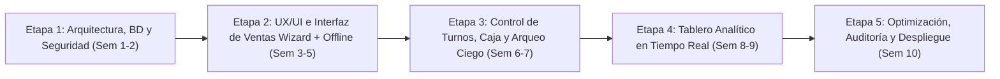

# Plan de Implementación por Etapas — Sistema de Conteo de Ventas y Arqueo de Caja

**Ubicación del Proyecto:** `d:\Mis Documentos\Escritorio\Programacion\Proyectos\Caja y Arqueo`  
**Objetivo:** Aplicación de conteo rápido de ventas (POS táctil por pasos), control de turnos/cajas, arqueo ciego y analítica en tiempo real con soporte *Offline-First* para almacén/minimercado.

---

## 1. Definición de Perfiles, Responsabilidades, Entregables y Herramientas

| ID | Perfil | Responsabilidades Principales | Entregables Clave | Herramientas y Stack |
| :--- | :--- | :--- | :--- | :--- |
| **P1** | **Programación Backend** | Lógica de negocio, API REST/WebSockets, motor de sincronización offline-online, RBAC, cálculo de saldos esperados vs. arqueo ciego, gestión de cuentas corrientes y pagos combinados. | API de ventas/turnos/arqueo, servicio de eventos en tiempo real (SSE/WebSockets), middleware RBAC, worker de sincronización e ingesta de audit logs. | Node.js / TypeScript (Fastify o NestJS) o Python (FastAPI), JWT, Socket.io / SSE, Zod, Vitest/Pytest. |
| **P2** | **Diseño de Base de Datos** | Modelado relacional y almacenamiento local (cliente), índices para analítica en <2 s, tablas inmutables (*append-only*) para auditoría, políticas de resolución de conflictos en sincronización offline. | Diagrama Entidad-Relación (DER), scripts DDL/migraciones, vistas materializadas para histórico (7/30/90 días), esquema local IndexedDB/SQLite. | PostgreSQL / SQLite (servidor), Prisma / Drizzle ORM, Dexie.js (IndexedDB en cliente para RNF03), pgAdmin / DBeaver. |
| **P3** | **Diseño UX/UI Experimentado** | Diseño de la interfaz de ingreso de ventas por pasos (*wizard* táctil de cero tipeo), maquetado de alta visibilidad para el dashboard en vivo, accesibilidad por teclado POS y pruebas de usabilidad táctil. | Sistema de diseño (tokens de alto contraste), prototipos interactivos del flujo de 5 pasos, componentes frontend reactivos, vistas de arqueo ciego y tablero analítico. | Figma, React / Vue / Next.js, Tailwind CSS, Zustand/Pinia (estado local), Chart.js / ECharts, PWA (Service Workers). |
| **P4** | **Gestor de Proyectos Senior** | Planificación, seguimiento de hitos, control de alcance (trazabilidad ERS ↔ entregables), gestión de riesgos, coordinación entre perfiles y validación de criterios de aceptación con el cliente. | Cronograma (Gantt/Kanban), matriz de trazabilidad de RF/RNF, reportes de avance por etapa, actas de validación de hitos y plan de contingencia. | Jira / Linear / GitHub Projects, Notion / Markdown Docs, Git (control de ramas y releases). |
| **P5** | **Optimizador de Recursos** | Auditoría de latencia (<1 s por ticket, ≤2 s en dashboard), optimización de consultas SQL y payload de red, perfilado de memoria en terminales POS de bajos recursos y pruebas de estrés. | Informe de *benchmarking* de rendimiento, optimización de índices y caché, configuración de *bundling* ligero para PWA offline, pruebas de carga y concurrencia. | Lighthouse, k6 / Artillery (load testing), Chrome DevTools Performance, EXPLAIN ANALYZE (SQL), Redis / caché en memoria. |

---

## 2. Arquitectura de Cobertura ERS (Matriz de Trazabilidad Actualizada)

> [!IMPORTANT]
> **Regla de Negocio Estructural (Sin Stock ni Catálogo de Productos):** El sistema **no utiliza control de stock, códigos de barras ni nombres/precios de productos individuales**. Toda referencia en el documento original a "lector de códigos", "cambiar precios" o "anular un producto" queda supeditada a esta regla: en el cobro solo se registran **cantidad de unidades, rubro(s)/familia(s) e importe cobrado**, y las anulaciones operan a nivel de **línea de rubro o ticket completo**.

| Código Informe | Código Inicial | Requisito | Etapa | Perfiles | Tablero Vivo |
| :--- | :--- | :--- | :--- | :--- | :---: |
| **RF-01** | RF01.1 | Apertura de caja por turno/cajero con fondo inicial | Etapa 3 | P1, P2, P3 | Sí |
| **RF-02** | RF01.2 | Entradas y salidas de dinero (proveedores, insumos, retiros) con motivo y autorizador | Etapa 3 | P1, P2, P3 | No |
| **RF-03** | RF04.1 | Consulta de recaudación al instante (Efectivo esperado en cajón + medios digitales) | Etapa 4 | P1, P3, P5 | Sí |
| **RF-04** | RF01.3 | Arqueo ciego al cierre (efectivo y cupones sin ver saldo esperado) | Etapa 3 | P1, P2, P3 | Sí |
| **RF-05** | RF01.4 | Reporte de faltantes, sobrantes o cuadre exacto al cerrar | Etapa 3 | P1, P2, P3 | Sí |
| **RF-06** | RF02.1 | Identificación por cajero (ventas, anulaciones y movimientos vinculados) | Etapa 2 / 3 | P1, P2, P3 | No |
| **RF-07** | RF02.2 | Rendimiento por empleado en vivo (total $, tickets, ticket promedio, % participación) | Etapa 4 | P1, P2, P3, P5 | Sí |
| **RF-08** | RF02.3 | Gestión de turnos separados (ej. Mañana y Tarde) sin mezclar recaudaciones | Etapa 3 | P1, P2, P3 | Sí |
| **RF-10** | RF03.1 | 5 Medios de pago: Efectivo (con vuelto), Débito, Crédito, Transferencia/QR y Cta. Cte. (fiado) | Etapa 2 / 3 | P1, P2, P3 | Sí |
| **RF-11** | RF03.1 | Pagos combinados en una misma compra (2 o más medios de pago) | Etapa 2 | P1, P2, P3 | Sí |
| **RF-12** | RF03.2 | Clasificación por rubro/familia (sin productos individuales ni códigos) | Etapa 1 / 2 | P1, P2, P3 | No |
| **RF-13** | RF04.1 | Tablero principal en vivo (recaudación, efectivo en caja, tickets, ticket promedio) | Etapa 4 | P1, P3, P5 | Sí |
| **RF-14** | RF04.2 | Nivel de ventas por franja horaria (ej. 08:00 a 21:00 h) en gráfico y tabla | Etapa 4 | P1, P2, P3 | Sí |
| **RF-15** | RF04.4 | Nivel de ventas por día (comparativa lunes a domingo, evolución mensual y 7/30/90 días) | Etapa 4 | P1, P2, P3, P5 | Sí |
| **RF-16** | RF04.3 | Desglose visual por rubro y por medio de pago (Efectivo vs. Tarjetas vs. QR) | Etapa 4 | P1, P2, P3 | Sí |
| **RF-17** | RF04.5 | Filtros rápidos (fecha, turno, empleado, rubro) en 1 clic + **Exportación a Excel y PDF** | Etapa 4 | P1, P3, P5 | Sí |
| **RNF-01** | RNF01 | Velocidad: cobro <1 s; actualización de tableros en vivo ≤2 s | Etapa 2 / 4 / 5 | P1, P2, P5 | - |
| **RNF-02** | RNF03 | Modo Offline en cajas con sincronización automática al volver internet | Etapa 2 / 5 | P1, P2, P3, P5 | - |
| **RNF-03** | RNF02 | **3 Roles estrictos:** Cajero, Supervisor (solo ve total de caja de turno, sin reportes) y Dueño (acceso total) | Etapa 1 / 3 / 4 | P1, P2, P3 | - |
| **RNF-04** | RNF02 | Historial de auditoría inalterable (anulaciones de líneas/tickets, aperturas de cajón sin venta) | Etapa 1 / 3 / 5 | P1, P2, P4 | - |
| **RNF-05** | RNF04 | Usabilidad: botones grandes táctiles / teclado rápido, curva de aprendizaje de minutos | Etapa 2 / 4 | P3, P5 | - |
| **RNF-06** | *Nuevo* | **Acceso remoto para el Dueño** desde celular o PC de oficina sin interrumpir la caja | Etapa 4 / 5 | P1, P3, P5 | Sí |

---

## 3. Plan de Implementación por Etapas

### Etapa 1: Cimientos, Modelo de Datos (Sin Stock), Catálogos Administrables y Seguridad (3 Roles)
**Duración estimada:** 2 semanas (80 hs)  
**Objetivo:** Establecer la base de datos relacional y local orientada a cobro por rubros/cantidades (sin inventario ni productos individuales), el sistema de permisos en **3 niveles estrictos (`RNF-03`)** y las tablas maestras administrables.

- **Alcance (RF/RNF):** RF-06 (base), RF-12 (catálogo de rubros), RNF-03 (RBAC en 3 roles: Cajero, Supervisor, Dueño) y RNF-04 (estructura de Audit Log inalterable).
- **Esquema de Permisos (`RNF-03`):**
  - **Cajero:** Cobrar ventas, registrar gastos/movimientos menores y ejecutar el arqueo ciego al cierre (sin ver saldos esperados ni reportes).
  - **Supervisor:** Autorizar entradas/salidas de caja (`RF-02`) y visualizar **únicamente el total de caja del turno activo**; bloqueado el acceso a reportes de ventas, analítica e históricos de recaudación.
  - **Dueño:** Acceso total en tiempo real (local y remoto `RNF-06`), todos los reportes financieros, saldos esperados al instante (`RF-03`), diferencias de arqueo (`RF-05`), configuración de rubros y anulación de ventas/tickets.
- **Participación por Perfil:**
  - **P2 (Diseño BD - Líder de etapa):** Diseña esquemas de `usuarios`, `roles` (Cajero, Supervisor, Dueño), `turnos_caja`, `movimientos_caja`, `ventas`, `lineas_venta_rubro` (solo `cantidad`, `rubro_id`, `subtotal` — sin SKU ni productos), `pagos_venta` (soporte de pagos combinados en los 5 medios), `rubros`, `medios_pago`, `clientes_fiado` y tabla *append-only* `audit_logs`.
  - **P1 (Backend):** Implementa autenticación, guardias RBAC para los 3 roles, CRUD de entidades administrables (empleados, rubros, medios de pago) y servicio de auditoría (timestamp, usuario, terminal, evento).
  - **P4 (Gestor de Proyectos):** Define estructura del repositorio, entorno de desarrollo, criterios de aceptación y matriz de riesgos inicial.
  - **P5 (Optimizador):** Define arquitectura de sincronización local-remota (UUIDv7 ordenables por tiempo generados en cliente para evitar colisiones offline).
- **Hito H1:** Base de datos operativa con semillas dinámicas (Almacén, Bebidas, Lácteos, Fiambrería, Panadería, Limpieza) y API de autenticación con los 3 roles validada.
- **Entregables:** Esquema SQL + migraciones, documentación de API base, matriz RBAC de 3 niveles implementada.

---

### Etapa 2: Diseño UX/UI e Interfaz de Ingreso de Ventas por Pasos (*Wizard* POS Sin Stock) + Motor Offline
**Duración estimada:** 3 semanas (120 hs)  
**Objetivo:** Construir el flujo de carga rápida de ventas basado exclusivamente en **cantidad + rubro + monto** (sin lector de códigos ni catálogo de artículos), con soporte 100% táctil/teclado POS y persistencia offline inmediata (<1 s).

- **Alcance (RF/RNF):** RF-06, RF-10 (5 medios de pago: Efectivo con vuelto, Débito, Crédito, Transferencia/QR, Cuenta Corriente), RF-11 (pagos combinados), RF-12, RNF-01 (registro <1 s), RNF-02 (modo offline), RNF-05 (usabilidad táctil y teclado rápido).
- **Diseño de la Interfaz de Ingreso de Ventas (Wizard de 5 Pasos):**
  1. **Paso 1 — Empleado:** Grilla de botones táctiles grandes generados dinámicamente desde la BD (o preseleccionado según sesión activa del cajero, con cambio en 1 toque). Avance automático al tocar.
  2. **Paso 2 — Cantidad e Importe:** Teclado numérico en pantalla (y captura directa de Numpad físico) para ingresar cantidad de unidades e importe (sin escanear productos individuales), con validación estricta de rango (> 0, no vacío).
  3. **Paso 3 — Rubro / Familia:** Botones grandes de alto contraste generados desde la BD (*Almacén, Bebidas, Lácteos, Fiambrería, Panadería, Limpieza*, etc.), permitiendo asociar uno o varios rubros a la venta o avanzar automáticamente.
  4. **Paso 4 — Medio de Pago (5 opciones + Combinado):** Botones grandes para *Efectivo, Tarjeta de Débito, Tarjeta de Crédito, Transferencia/QR (Mercado Pago) y Cuenta Corriente (Fiado)*. Incluye calculadora automática de vuelto para efectivo (`RF-10`) y modalidad de **Pago Combinado (`RF-11`)** para dividir una misma compra entre dos o más medios.
  5. **Paso 5 — Resumen y Confirmación Editable:** Vista compacta con todos los datos seleccionados; tocar cualquier campo regresa directamente a ese paso para corregirlo sin perder el resto. Botón de confirmación gigante (`Enter` en teclado físico).
  - **Componentes transversales del Wizard:** Barra de progreso superior, botón **"Atrás"** persistente (`Backspace`/`Esc`), indicador de estado de red (Online / Offline con cola pendiente).
- **Participación por Perfil:**
  - **P3 (UX/UI y Frontend - Líder de etapa):** Diseña e implementa el *wizard* paso a paso con avance automático, botones táctiles (`min-height: 64px`), atajos de teclado físico y validación en tiempo real.
  - **P1 (Backend):** Desarrolla endpoints de creación de tickets por rubro/cantidad, validación de tope de cuenta corriente, lógica de pagos combinados (`RF-11`) y endpoint de sincronización por lotes (*batch sync*) para ventas registradas offline.
  - **P2 (Diseño BD):** Configura la base de datos local en el navegador (IndexedDB / Dexie.js) espejo de los catálogos administrables y la cola de transacciones pendientes (`outbox_queue`).
  - **P5 (Optimizador):** Garantiza que el guardado local + encolado ocurra en **<100 ms** (cumpliendo holgadamente RNF-01 <1 s) y optimiza el Service Worker para funcionamiento sin internet (`RNF-02`).
  - **P4 (Gestor de Proyectos):** Coordina pruebas de usabilidad cronometradas (conteo de toques por venta y aprendizaje en pocos minutos según `RNF-05`).
- **Hito H2:** Cajero puede registrar ventas simples y combinadas por rubro en <5 segundos con 0 errores de tipeo, tanto online como sin internet.
- **Entregables:** Prototipo UI validado, módulo Frontend POS Wizard, motor PWA Offline + sincronización automática.

---

### Etapa 3: Control de Turnos, Entradas/Salidas y Arqueo Ciego
**Duración estimada:** 2 semanas (80 hs)  
**Objetivo:** Implementar el ciclo de vida completo de cada puesto de cobro, relevo de turnos (Mañana/Tarde), entradas/salidas de efectivo autorizadas y cierre mediante arqueo ciego auditado.

- **Alcance (RF/RNF):** RF-01, RF-02, RF-04, RF-05, RF-08, RNF-03 (vista acotada del Supervisor al total de caja del turno vs. vista completa del Dueño) y RNF-04 (auditoría de anulaciones y aperturas de cajón sin venta).
- **Participación por Perfil:**
  - **P1 (Backend - Líder de etapa):** Lógica de apertura de turno con fondo inicial (`RF-01`), registro de entradas/salidas con motivo y autorizador (`RF-02`), bloqueo estricto de saldo esperado para el rol `Cajero` (`RF-04`), endpoint exclusivo de total de turno actual para `Supervisor` (`RNF-03`) y reporte automático de cuadre, faltante o sobrante para el `Dueño` (`RF-05`).
  - **P3 (UX/UI y Frontend):** Pantallas de apertura de turno, modal rápido de entrada/salida de efectivo, formulario táctil de **Arqueo Ciego** (efectivo físico y cupones sin mostrar totales del sistema) y vista diferenciada para Supervisor (solo total de turno) y Dueño (reporte de diferencias y auditoría).
  - **P2 (Diseño BD):** Consultas transaccionales de cierre de turno (`SELECT FOR UPDATE` / aislamiento transaccional) para consolidar: $\text{Efectivo Esperado} = \text{Fondo Inicial} + \text{Ventas Efectivo} + \text{Entradas} - \text{Salidas}$.
  - **P4 (Gestor de Proyectos):** Valida las reglas de negocio en relevos de turno (`RF-08`) y flujos de auditoría antirrobo (`RNF-04`).
- **Hito H3:** Ciclo completo de Apertura → Ventas + Salida a Proveedor → Arqueo Ciego → Reporte de Faltante/Sobrante ejecutado con trazabilidad en el Audit Log.
- **Entregables:** Módulo de Gestión de Turnos y Arqueo Ciego, vista acotada de Supervisor y registro de auditoría antirrobo.

---

### Etapa 4: Tablero Principal en Vivo, Reportes Exportables y Acceso Remoto para el Dueño
**Duración estimada:** 2 semanas (80 hs)  
**Objetivo:** Construir el dashboard en tiempo real (≤2 s tras cada venta) exclusivo para el **Dueño**, accesible tanto desde PC de oficina como desde el **teléfono celular (`RNF-06`)**, con exportación a **Excel y PDF (`RF-17`)**.

- **Alcance (RF/RNF):** RF-03, RF-07, RF-13, RF-14, RF-15, RF-16, RF-17, RNF-01 (dashboard ≤2 s), RNF-03 (exclusivo Dueño), RNF-06 (acceso remoto móvil/oficina).
- **Cobertura del Tablero y Reportes para el Dueño:**
  - **Tablero Principal en Vivo (`RF-03`, `RF-13`):** Recaudación total al segundo, **efectivo que debería haber en el cajón físico** ($\text{Fondo inicial} + \text{Ventas en efectivo} - \text{Salidas}$), ingresos por medios digitales, cantidad de tickets emitidos y ticket promedio.
  - **Rendimiento por Empleado (`RF-07`):** Total vendido ($), cantidad de tickets, ticket promedio ($) y % de participación sobre la venta total del local.
  - **Nivel de Ventas por Hora (`RF-14`):** Gráfico y tabla por franja horaria (ej. 08:00 a 21:00 h) para detectar horarios pico.
  - **Nivel de Ventas por Día (`RF-15`):** Comparativa día por día (lunes a domingo), evolución mensual y ventanas históricas (7, 30 y 90 días).
  - **Ventas por Rubro y Medio de Pago (`RF-16`):** Desglose visual por familia de producto y por forma de pago (Efectivo vs. Débito vs. Crédito vs. Transferencia/QR vs. Cuenta Corriente).
  - **Filtros Rápidos en 1 Clic + Exportación (`RF-17`):** Filtrado instantáneo por fecha, turno, empleado o rubro sin recargar la página, más botones de descarga directa a **Excel (`.xlsx`) y PDF**.
  - **Acceso Remoto Responsivo (`RNF-06`):** Diseño adaptativo (*mobile-first* para celular del dueño y *widescreen* para oficina) sincronizado en vivo sin interrumpir la operación de la caja.
- **Participación por Perfil:**
  - **P3 (UX/UI y Frontend - Líder visual):** Diseña e implementa el dashboard en modo alto contraste y versión móvil para el celular del dueño (`RNF-06`), con filtros en 1 clic.
  - **P1 (Backend):** Implementa canal WebSockets / SSE para actualización en ≤2 s y servicio generador de reportes descargables en **Excel (`exceljs`/`sheetjs`) y PDF (`pdfkit`/`jspdf`)** (`RF-17`).
  - **P2 (Diseño BD):** Crea índices compuestos por `(fecha, dia_semana, hora, turno_id, cajero_id, rubro_id)` y vistas pre-agregadas para comparativas semanales y mensuales (`RF-15`).
  - **P5 (Optimizador):** Configura acceso remoto seguro (Cloud / túnel HTTPS con sincronización en vivo desde la caja local) y optimiza payloads móviles para el celular del dueño (`RNF-06`).
  - **P4 (Gestor de Proyectos):** Verifica que el rol Supervisor no tenga acceso a estas rutas (`RNF-03`) y valida los formatos de exportación Excel/PDF.
- **Hito H4:** Venta ingresada en caja impacta en <2 segundos en el celular del Dueño y permite exportar cualquier corte filtrado a Excel y PDF.
- **Entregables:** Tablero Principal Live (Web + Móvil), módulo de exportación Excel/PDF y consultas analíticas por hora/día/mes.

---

### Etapa 5: Optimización Integral, Pruebas de Estrés, Auditoría de Seguridad y Puesta en Producción
**Duración estimada:** 1 semana (40 hs)  
**Objetivo:** Certificar todos los Requisitos No Funcionales (RNF01 a RNF04), validar recuperación ante cortes de luz/internet y desplegar la solución lista para operar en el local.

- **Alcance (RF/RNF):** Certificación final de RNF01, RNF02, RNF03, RNF04 y cierre de proyecto.
- **Participación por Perfil:**
  - **P5 (Optimizador de Recursos - Líder de etapa):** Ejecuta pruebas de estrés simulando ráfagas de alta rotación (múltiples ventas por minuto e historial de 90 días con decenas de miles de tickets), validando tiempos `<1 s` en caja y `≤2 s` en dashboard.
  - **P1 y P2 (Backend y BD):** Pruebas de caos en sincronización offline (desconexión prolongada, reconexión simultánea de 2 puestos, integridad de saldos y verificación de inmutabilidad del Audit Log).
  - **P3 (UX/UI):** Ajustes finos de ergonomía táctil y calibración de contraste en los monitores reales del comercio.
  - **P4 (Gestor de Proyectos):** Capacitación rápida a cajeros y supervisores, entrega de manual operativo y acta de cierre.
- **Hito H5 (Go-Live):** Sistema certificado en entorno productivo local/nube con tiempos de respuesta validados.
- **Entregables:** Reporte de certificación RNF, instalador/despliegue PWA + Servidor, manual de operación y respaldo automático.

---

## 4. Estimación de Esfuerzo: Horas-Persona vs. Ejecución con Agentes de IA

### 4.1 Esfuerzo en Horas-Persona (Desarrollo Manual Tradicional)
Las **400 horas** originales corresponden a **horas-hombre de trabajo manual**. El acumulado por rol es:

| Etapa | P1: Backend | P2: Base de Datos | P3: UX/UI & Front | P4: Gestor Proy. | P5: Optimizador | **Total Etapa** |
| :--- | :---: | :---: | :---: | :---: | :---: | :---: |
| **Etapa 1: Arquitectura, BD y RBAC** | 28 h | 30 h | 4 h | 10 h | 8 h | **80 h** |
| **Etapa 2: Wizard Ventas POS + Offline** | 28 h | 16 h | 50 h | 10 h | 16 h | **120 h** |
| **Etapa 3: Turnos, Caja y Arqueo Ciego** | 32 h | 12 h | 24 h | 8 h | 4 h | **80 h** |
| **Etapa 4: Dashboard Analítico Live** | 24 h | 16 h | 26 h | 6 h | 8 h | **80 h** |
| **Etapa 5: QA, Optimización y Despliegue** | 8 h | 6 h | 6 h | 6 h | 14 h | **40 h** |
| **Total Acumulado por Rol (Manual)** | **120 h** | **80 h** | **110 h** | **40 h** | **50 h** | **400 h (10 sem)** |

---

### 4.2 Esfuerzo con Agentes de IA y Estrategia de Modelos (Ahorro de Tokens con Cambio Manual)
Ejecutando el proyecto con agentes de IA bajo tu supervisión, las 400 hs manuales se comprimen a **~22 horas reales de interacción/ejecución** (~94% menos tiempo). Para minimizar el consumo de tokens sin estar cambiando de modelo a cada minuto, se agrupan las tareas en **2 bloques por etapa** (1 cambio manual por bloque):

- **Nivel Pesado / Razonamiento (Gemini Argon High / Claude Sonnet Thinking):** Solo para diseño arquitectónico, esquemas críticos, motor de sincronización offline y conciliación financiera (~30% del tiempo).
- **Nivel Ágil / Ejecución (Gemini Argon Low-Medium / Gemini Flash):** Para CRUDs, componentes UI, gráficos, exportación Excel/PDF, tests y maquetado (~70% del tiempo).

| Etapa / Bloque de Trabajo (Cambio Manual de Modelo) | Rol IA Activo | Tiempo IA | Modelo Recomendado | Motivo (Eficiencia de Tokens) |
| :--- | :--- | :---: | :--- | :--- |
| **E1 - Bloque A:** Diseño DER, triggers `audit_logs`, arquitectura UUIDv7 y RBAC 3 roles | P2 + P1 + P5 | **1.5 h** | **Gemini Argon High** | Decisiones estructurales; un error aquí arrastra deuda a todo el proyecto. |
| **E1 - Bloque B:** Migraciones SQL, semillas de rubros/medios, CRUDs base y setup repo | P1 + P2 + P4 | **2.0 h** | **Argon Low-Medium / Flash** | Código repetitivo y predecible; no requiere gastar tokens de alto razonamiento. |
| **E2 - Bloque A:** Motor Offline (IndexedDB + Outbox Queue + Batch Sync sin colisiones) | P1 + P2 + P5 | **2.5 h** | **Gemini Argon High** | Alta complejidad de concurrencia y manejo de fallos de red (`RNF-02`). |
| **E2 - Bloque B:** UI Wizard de 5 pasos táctil, calculadora de vuelto y pagos combinados | P3 + P1 | **3.5 h** | **Argon Low-Medium / Flash** | Generación rápida de componentes React/Tailwind y validaciones de formulario. |
| **E3 - Bloque A:** Transacciones de cierre, arqueo ciego (`RF-04`) y cálculo de diferencias | P1 + P2 | **2.0 h** | **Gemini Argon High** | Lógica financiera crítica y aislamiento de permisos Cajero/Supervisor/Dueño. |
| **E3 - Bloque B:** Pantallas de apertura, entradas/salidas y vistas de Supervisor/Dueño | P3 + P4 | **2.0 h** | **Argon Low-Medium / Flash** | Maquetado de pantallas y conexión directa a endpoints ya definidos. |
| **E4 - Bloque A:** Streaming SSE/WebSockets ≤2 s y consultas agregadas (hora/día/mes) | P1 + P2 + P5 | **2.0 h** | **Gemini Argon High** | Optimización de queries SQL e índices para cumplir `<2 s` (`RNF-01`). |
| **E4 - Bloque B:** Dashboard en vivo (PC + Móvil `RNF-06`), filtros y exportador Excel/PDF | P3 + P1 | **3.5 h** | **Argon Low-Medium / Flash** | Gráficos, tablas responsivas y uso de librerías estándar (`exceljs`/`jspdf`). |
| **E5 - Bloque Único:** Tests E2E/estrés, simulación de corte de red y script de despliegue | P5 + P4 | **3.0 h** | **Argon Low-Medium / Flash** *(High solo si falla un bug)* | Ejecución de pruebas automatizadas, ajustes de CSS y documentación final. |
| **Total Ejecución con IA** | **P1 a P5** | **22.0 h** | **~8.0 h Argon High / ~14.0 h Low-Flash** | **Ahorro del ~70% en costo de tokens haciendo solo 8 cambios manuales en todo el proyecto.** |

**Resumen acumulado por Rol en modalidad Agente IA (22 h totales):**
- **P1 (Backend):** 7.0 h | **P2 (Base de Datos):** 4.0 h | **P3 (UX/UI & Front):** 6.5 h | **P4 (Gestor/QA Docs):** 1.5 h | **P5 (Optimizador):** 3.0 h.

---

## 5. Matriz de Riesgos y Mitigación

| ID | Riesgo Identificado | Probabilidad | Impacto | Estrategia de Mitigación | Responsable |
| :--- | :--- | :---: | :---: | :--- | :--- |
| **R01** | **Conflictos de datos al reconectar tras operar Offline (RNF03)** (ej. dos cajas otorgan fiado al mismo cliente superando su límite sin red). | Media | Alto | Uso de identificadores únicos `UUIDv7` ordenados cronológicamente; sincronización basada en eventos (*append-only* de ventas); alerta automática al Supervisor si un límite de cuenta corriente fue excedido durante un corte de red. | P1, P2 |
| **R02** | **Pérdida de ventas offline por limpieza de caché del navegador en la terminal POS.** | Baja | Crítico | Configurar PWA con `navigator.storage.persist()`, bloqueo de cierre accidental de pestaña cuando `outbox_queue > 0` y respaldo automático en disco local / SQLite local si se ejecuta en contenedor de escritorio. | P2, P5 |
| **R03** | **Degradación del Dashboard (>2 s) al acumular histórico de 90 días (RF04.4, RNF01).** | Media | Medio | Implementar tablas/vistas pre-agregadas diarias al cierre de cada jornada; el cálculo en vivo solo procesa el turno/día actual y lo combina con los agregados históricos indexados. | P2, P5 |
| **R04** | **Errores de pulsación en horas pico en la interfaz táctil.** | Media | Alto | Botones con área mínima de `64x64 px`, espaciado generoso (`gap >= 12px`), validación de topes lógicos en cantidades/montos y Paso 5 de confirmación editable en 1 toque antes de persistir. | P3 |
| **R05** | **Manipulación de arqueos o visualización previa del saldo esperado por parte del cajero (RF01.3, RNF02).** | Baja | Alto | El endpoint de arqueo para rol `Cajero` jamás envía el campo `saldo_esperado` en el payload JSON; toda consulta de diferencias o reapertura queda grabada en `audit_logs` inalterable. | P1, P2 |

---

## 6. Recursos Necesarios

### 6.1 Recursos Humanos
- Equipo multidisciplinario de los **5 perfiles** definidos (puede ejecutarse con dedicación parcial/escalonada según la tabla de esfuerzo de la Sección 4).

### 6.2 Recursos de Hardware (Entorno de Almacén/Minimercado)
- **Puestos de Caja (POS):** PC o All-in-One con pantalla táctil (15" o superior) y/o teclado físico con pad numérico (mínimo 4 GB RAM, navegador moderno con soporte IndexedDB/Service Workers), cajón de dinero con apertura eléctrica RJ11.
- **Pantalla de Supervisión / Analítica:** Monitor o tablet en mostrador/oficina gerencial para visualizar el Dashboard en vivo en alto contraste (RNF04).
- **Servidor Local o Cloud Híbrido:** Mini-PC local en red LAN del comercio (garantiza latencia <1 s incluso si se corta el proveedor de internet externo) o VPS Cloud con réplica local.

### 6.3 Recursos de Software
- **Frontend:** Aplicación Web Progresiva (PWA) en React / Next.js o Vue + Tailwind CSS + Dexie.js (almacenamiento offline) + librerías de gráficos ligeras.
- **Backend y BD:** Node.js (Fastify/NestJS) o Python (FastAPI) + PostgreSQL / SQLite con soporte WAL (Write-Ahead Logging) para alta concurrencia y bajo consumo de recursos.
